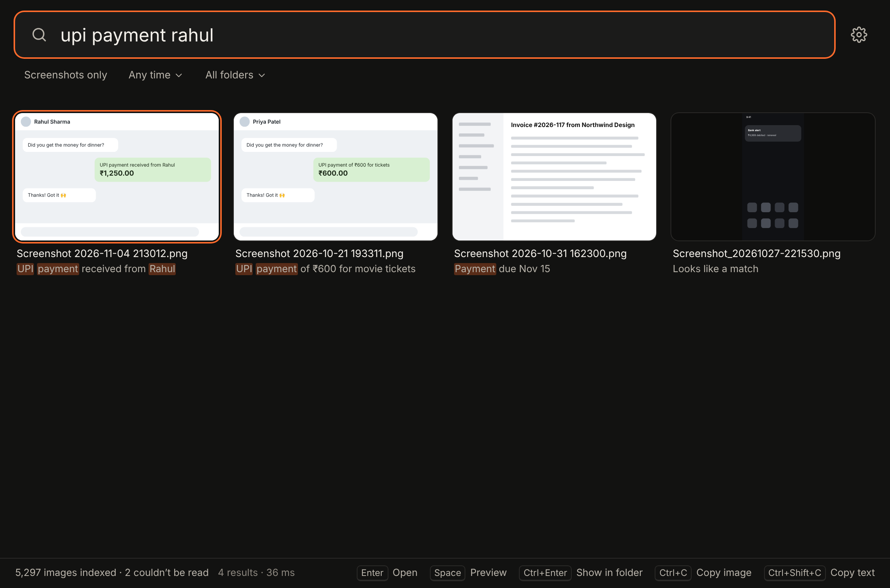
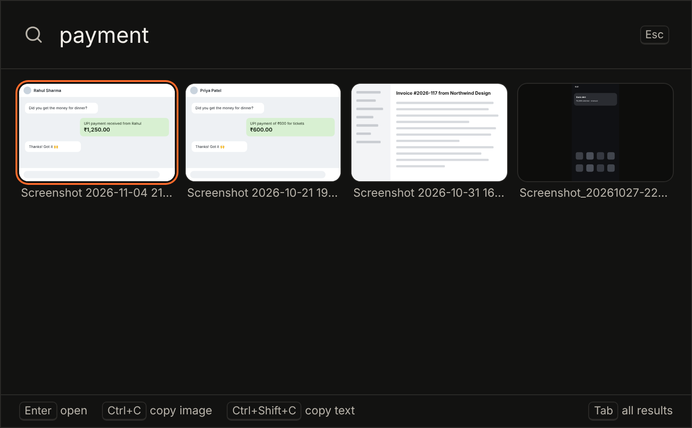
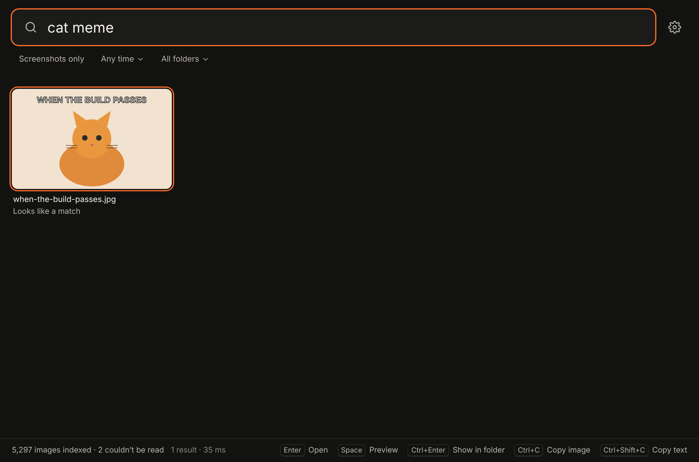
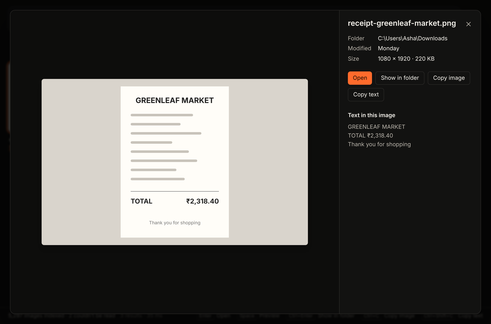
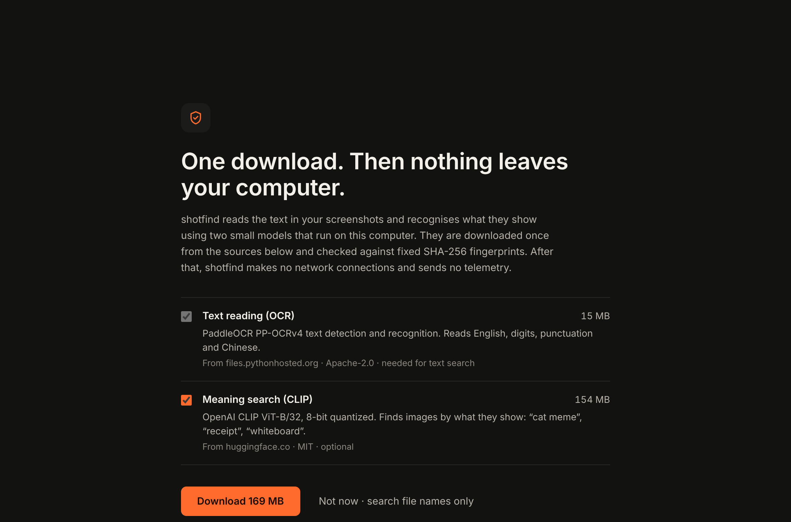
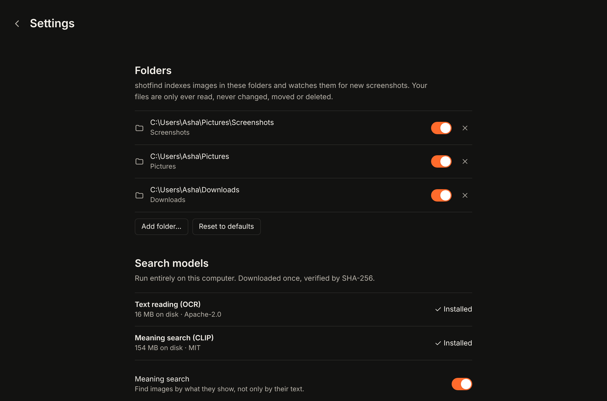

# shotfind

**Type what you remember, find the screenshot in under a second. Nothing leaves your computer.**

<!-- TODO: replace with a real screen recording (docs/demo.gif). -->


shotfind is an open-source desktop app that makes every screenshot and image on your computer searchable. It reads the text in each image (OCR) and recognises what the image shows (CLIP). Then you can search for `error 404`, `UPI payment Rahul`, `cat meme` or `whiteboard notes` and get a grid of matching thumbnails as you type. Press **Alt+Shift+S** anywhere to open a Spotlight-style search bar.

Windows first, with macOS and Linux builds from the same code.

| | |
|---|---|
|  |  |
|  |  |
|  |  |

*These screenshots were rendered against the built-in mock backend (`npm run screenshots`). Captures of the real app running on Linux are in [`docs/screenshots/real-app-linux-*.png`](docs/screenshots).*

## Features

- **Text search inside images.** Every image is OCR'd. Search is typo-tolerant: `paymnet` finds "payment", and OCR look-alikes such as `UPl` and `UPI` count as the same word. It matches word prefixes while you type. Numbers have to match exactly, so `404` never finds `401`.
- **Meaning search.** CLIP embeddings find images by content even when there's no text in them (`receipt`, `cat`, `bar chart`).
- **Combined ranking.** Text matches and meaning matches go into one ranking, and images that match both rank higher.
- **Filters:** a folder, a date range (today, 7 days, 30 days, a year) and *screenshots only*.
- **Result actions:** open, show in folder, copy the image, copy its extracted text, and a full-size preview.
- **Global hotkey** (default **Alt+Shift+S**, configurable) opens a quick search bar from anywhere.
- **Background indexing** runs at low priority. You can pause and resume it, it resumes after a crash, and a file watcher picks up new screenshots within seconds.
- **Default folders:** your OS screenshots folder, Pictures and Downloads (images only). You can add or remove folders.
- **Formats:** PNG, JPG/JPEG, WebP, GIF (first frame) and BMP. HEIC/AVIF files are recognised but not decoded yet (see good first issues).

## Privacy

- **Read-only.** shotfind never modifies, moves or deletes your images. In the code, user files are opened only through a read-only helper (`userfs.rs`). Every write goes through `AppData`, which refuses any path outside the app data folder. A test checks this statically (no file-writing APIs outside `appdata.rs`). Another test checks it behaviourally: it indexes a read-only folder, re-indexes, wipes the index and removes folders, then confirms every file is byte-for-byte identical with the same mtime and permissions.
- **One download, then offline.** Two models are downloaded on first run, and only after you agree on the consent screen. That screen shows the sizes, sources and licenses. Every file is checked against a SHA-256 pinned in [`models.json`](crates/shotfind-core/models.json), and anything that doesn't match is discarded. After that, shotfind makes **no network connections**. It has no telemetry, no analytics, no update pings and no account. All the networking code lives in one module (`models.rs`) behind a cargo feature.
- **Offline install.** If the machine never goes online, use *Install from a folder*. It accepts model files copied from another machine and verifies their hashes too.
- **Your index stays local.** The OCR text, thumbnails and vectors live in the app data folder (`%LOCALAPPDATA%\io.github.shotfind` on Windows, `~/Library/Application Support/io.github.shotfind` on macOS, `~/.local/share/io.github.shotfind` on Linux). *Settings → Delete index* wipes it.
- **The UI can't reach your files directly.** The webview has no filesystem, shell or HTTP permissions. It asks the Rust side to act on an index *id*, and the Rust side resolves the path from the index itself.

## Install

> Builds are not code-signed yet, so the OS will warn you the first time.

**Windows 10/11.** Download `shotfind_x.y.z_x64-setup.exe` (or the `.msi`) from [Releases](https://github.com/adywakes/ss-search/releases) and run it. If SmartScreen says *"Windows protected your PC"*, click **More info → Run anyway**. WebView2 is installed automatically if it's missing.

**macOS 12+ (Apple Silicon or Intel).** Open the `.dmg` and drag shotfind to Applications. Because the build is unsigned, the first launch needs **right-click → Open → Open**, or run `xattr -dr com.apple.quarantine /Applications/shotfind.app`. Screenshots default to your Desktop on macOS, so the Desktop is indexed as your screenshots folder unless you changed the location.

**Linux (x64).** Use the `.AppImage` (`chmod +x shotfind_*.AppImage && ./shotfind_*.AppImage`) or the `.deb` (`sudo apt install ./shotfind_*.deb`). The global hotkey needs X11 or XWayland. Pure Wayland sessions don't allow global shortcuts for regular apps.

## How it works

```
 folders ──► scanner + watcher ──► SQLite queue ──► worker pool (low priority)
                                                    │  read (read-only) → decode → thumbnail
                                                    │  OCR: PP-OCRv4 detect → recognise
                                                    │  CLIP: image → 512-d vector
                                                    ▼
                                    SQLite (WAL): files · OCR text + FTS5 · vectors
                                                    │
 query ──► fuzzy FTS5 (vocab expansion) ─┐          │
       └─► CLIP text encoder → cosine ───┴─► combined rank ──► thumbnail grid
```

- **Tauri v2** shell with a Rust backend, and a React + TypeScript + Tailwind UI. All the engine logic is in [`crates/shotfind-core`](crates/shotfind-core), which has no Tauri dependency and is fully testable.
- **ONNX Runtime** (Microsoft's official build, pinned by SHA-256 and bundled with the app) runs both models on the CPU through the [`ort`](https://crates.io/crates/ort) crate.
- **OCR:** PaddleOCR **PP-OCRv4**. DBNet text detection runs with the long side capped at 1280 px, and very tall scrolling captures are tiled. SVTR recognition runs at 48 px height with CTC decoding. Digit look-alikes are normalised (`4O4` → `404`).
- **Embeddings:** OpenAI **CLIP ViT-B/32**, 8-bit quantized, with a Rust port of CLIP's BPE tokenizer. Wide screenshots are letterboxed instead of centre-cropped, so the model sees the whole screen.
- **Search:** SQLite **FTS5** over OCR text and file names. Each query word expands to vocabulary terms (exact, prefix, OCR look-alike, edit distance 1–2 depending on length). Vector search is brute-force cosine in memory, which is fine up to roughly 100k images. Both scores are combined into one ranking, with the tuning constants in `search::tuning`.
- **Crash safety:** each file's attempt is committed before work starts. A file that crashes the indexer 3 times is quarantined instead of crash-looping. Results are written in one transaction per file. Panics are isolated per file.

### Models and sizes

| Model | Purpose | Download | On disk | Source | License |
|---|---|---|---|---|---|
| PP-OCRv4 det + rec | Reads text | 14.9 MB | 15.6 MB | PyPI (`rapidocr_onnxruntime` wheel; only the two `.onnx` files are kept) | Apache-2.0 |
| CLIP ViT-B/32 (int8) | Finds images by content | ~154 MB | ~154 MB | Hugging Face (`Xenova/clip-vit-base-patch32`) | MIT |
| ONNX Runtime 1.22 | Runs the models | bundled | 12–33 MB | Microsoft GitHub release | MIT |

Meaning search is optional. Without CLIP you still get text and file-name search.

### Performance (measured on the 4-vCPU build VM)

- **Search:** worst query 84 ms on a synthetic 20,000-image index (`cargo test --release -p shotfind-core --test perf -- --ignored --nocapture`). The real app answered in 4 ms on a small library.
- **OCR:** about 0.35 s for detection plus 30–50 ms per text line, per CPU thread pair, for a dense 1080p screenshot. With the default *Balanced* speed (half your CPU threads, at background priority) that comes to roughly 3–5 minutes per 1,000 screenshots on a typical 8-thread laptop. *Fast* uses all but one thread.

## Build from source

Requirements: Rust (stable, 1.92+), Node 20+, and on Linux the [Tauri system packages](https://v2.tauri.app/start/prerequisites/).

```bash
npm install
```

```bash
node scripts/fetch-onnxruntime.mjs
```

```bash
npm run tauri dev
```

To build installers for your OS:

```bash
npm run tauri build
```

Tests (no models needed; synthetic images with known text are generated on the fly):

```bash
cargo test -p shotfind-core
```

Tests with the real models:

```bash
cargo run --release -p shotfind-core --example fetch_models -- ./.models-test
```

```bash
ORT_DYLIB_PATH=src-tauri/resources/onnxruntime/libonnxruntime.so SHOTFIND_MODELS_DIR=./.models-test/models cargo test --release -p shotfind-core -- --ignored
```

To work on the UI without the Rust backend, run `npm run dev` and open http://localhost:1420. A mock backend with generated images kicks in automatically. Add `?mock=onboarding`, `?mock=indexing` or `?view=bar` to the URL for other states.

## Contributing

Contributions are welcome. Some ground rules:

1. **Never write to user files.** Any new file access goes through `userfs` (read) or `AppData` (write). The `never_modify` tests must stay green, and if you need an exception, explain it in the PR.
2. **No new network calls.** The model downloader is the only exception. New models need an entry in `models.json` with a pinned SHA-256 (`node scripts/pin-models.mjs`).
3. **Tests come with behaviour changes.** Ranking changes need a case in `tests/search.rs`. Indexing changes need one in `tests/indexing.rs`.
4. Run `cargo fmt --all`, `cargo clippy --workspace --all-targets -- -D warnings` and `npm run typecheck` before pushing. CI runs the same checks.
5. Keep the UI quiet: one accent colour, real words instead of icons-only, and no nested cards.

Design decisions and their reasons are logged in [`DECISIONS.md`](DECISIONS.md).

### Good first issues

1. **Hindi / Devanagari OCR.** Add PaddleOCR's `devanagari_PP-OCRv3` recognition model as an optional download and pick the recogniser per text line (or let users choose OCR languages in Settings).
2. **Phone photo import.** Index a phone's DCIM folder over USB (MTP on Windows, Image Capture on macOS) or a synced folder, and tag those images separately from screenshots.
3. **Duplicate finder.** Use the existing CLIP vectors plus a perceptual hash to group near-identical screenshots, and show them in a review view. Deleting goes to the OS trash *only* after explicit confirmation, which also means extending the read-only policy carefully.
4. **HEIC/AVIF support.** Decode through the OS: WIC on Windows (needs the HEIF/HEVC extensions), ImageIO on macOS, libheif on Linux.
5. **Chinese/Japanese word search.** FTS5's `unicode61` tokenizer doesn't segment CJK text. Add a trigram FTS table for CJK runs.

## License

MIT. Bundled and downloaded third-party components are listed in [`THIRD_PARTY_NOTICES.md`](THIRD_PARTY_NOTICES.md).
